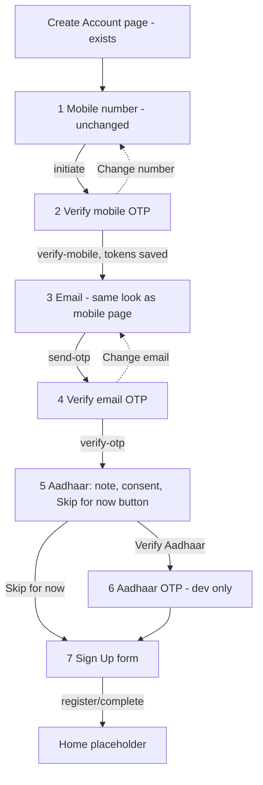

# US-001 Mobile Implementation Plan — User Registration (v3)

**Status:** v3.1, your answers of 2026-10-05 incorporated (section 11). **Implementation progress:** phases 1 to 8 implemented (foundation, auth data and domain, session and resume routing, mobile and email OTP, Aadhaar with screenshot protection, Sign Up, tests). Open: native review of Hindi strings, design review of the new components, real-device and iOS checks, final avatar artwork. One decision is still open (third-party Aadhaar provider) and does not block implementation.
**Governing rule:** `Documents/CODING_STANDARDS.md` (§1 all repos, §3 Flutter). The two exceptions recorded in v2 (localization, screenshot protection) are **rejected**; this plan follows the standards.
**Branch:** `feature/us-001-user-registration-mobile` (from `main`)
**Related:** `Documents/user-stories.md` (US-001, US-108), `Documents/LLD/Sprint-1-Identity-User-Management-LLD.md`, `Documents/US-001-Testing-Guide.md`, `docs/Flutter-Design-System.md`.

---

## 1. Decisions taken (2026-10-05)

| # | Decision | Effect |
|---|---|---|
| D1 | "Create your profile" (Figma `3:330`) **is the Sign Up screen**, and it is the **last** step of registration (after mobile, email and Aadhaar). | One form captures profile, address and terms. Backend must store the new fields (section 6). |
| D2 | **Do not change the mobile number page.** Terms and consent are collected on Sign Up. The "Terms and Conditions" link opens a T&C page; the acceptance toggle is **disabled until the user has opened and closed that page**. A template T&C page is built now; legal text comes later. | Backend stops requiring terms and consent at `register/initiate` (BR-2). |
| D3 | Remove "Skip for now" from the email page; it must **look consistent with the mobile number page**. | Email entry mirrors `SignupMobileScreen`. |
| D4 | **Separate OTP screens for mobile and email.** Aadhaar verification will be done by a **third party**; the Aadhaar OTP screen is **development only** until that integration exists, and is **visibly marked** as such. | `VerifyMobileOtpScreen`, `VerifyEmailOtpScreen`; `AadhaarDevOtpScreen` (section 4, screen 6). |
| D5 | Aadhaar page: the note below, **"Skip for now" is a button** that takes the user to Sign Up, plus a **consent checkbox**. | Section 4, screen 5. |
| D6 | **Resume of registration after app restart**, driven by the server account state. Added to US-001. | Section 3. |
| D7 | Landing after Sign Up: **Home placeholder**. | |
| D8 | **Environment switching** with config files (`--dart-define-from-file`). | Section 7.2. |
| D9 | **Follow CODING_STANDARDS.** Localization (`flutter_localizations`, ARB, English and Hindi) and screenshot protection on Aadhaar screens are **in scope now**. The v2 exceptions D9 and D10 are withdrawn. | Sections 7.5, 7.6. |
| D10 | **Design conflicts:** use our brand tokens; review with you before any deviation. New components with no Figma design (gender selector, date-of-birth field, avatar picker) are proposed in the theme styling and **approved by you after a screenshot** (design system section 6.1). | Section 5. |
| D11 | **New account state `SIGNUP_PENDING`** (renamed from `PROFILE_PENDING`). **I implement the backend changes** in a separate branch and PR in `valuex-backend`. | Section 6. |
| D12 | **One toggle** covers terms and data-processing consent. | `register/complete` sets both from it. |
| D13 | Sign Up adds **Gender** (Male, Female, Others), **Date of Birth** (typed or picked from a calendar) and **Pincode**. The avatar can be changed from a **set of avatars**; a **default avatar depends on gender**. | Section 4 screen 7; BR-1, BR-3, BR-6. |
| D14 | **Address** gets its own story: **US-108** (Google Places Autocomplete plus a backend address verification API), now in `user-stories.md` and Sprint 1 of `Sprint-plan.md`. Sign Up uses **manual** State, City, Address and Pincode until US-108 ships. | Section 2. |
| D15 | **Hindi:** I draft the strings; a **native speaker reviews** them before release. | Section 7.5 |
| D16 | **Screenshot protection:** use a maintained plugin (`screen_protector`), recommended approach A. | Section 7.6 |
| D17 | **SSL pinning, root/jailbreak detection and device ID are not part of this story.** No mobile security story existed, so **US-109 (Mobile App Security Hardening)** is created and planned in Sprint 1 (5 points, proposed). | Section 7.6 |
| D18 | **No minimum age** for date of birth; only a valid, non-future date. | Section 4, BR-3 |
| D19 | **Avatars:** US-003 owns the avatar catalog and picker. Sign Up uses the existing 12-id catalog with a **male-looking default, a female-looking default and a neutral default** (for Others). | Section 4, BR-6 |
| D20 | **US-108 is 3 story points.** `integration_test` is approved. **US-001 story amendments are approved and applied** in `user-stories.md`. The third-party Aadhaar provider is **not yet decided**. | Sections 6, 7.7, 11 |

Aadhaar note text (verbatim from you):
> You can ‘Skip for now’ but Aadhaar Verification is must before any transactions (Buy/Sell/Contact seller/buyer). So, before your first transaction, you must complete this one time Aadhaar Verification.

---

## 2. Scope

**In scope (mobile):** mobile number (existing, unchanged), mobile OTP, email entry, email OTP, Aadhaar (skip, or verify via the dev screen), Sign Up form (avatar, name, gender, date of birth, address, terms), T&C template page, session storage and resume, environment config, localization (English and Hindi), screenshot protection on Aadhaar screens, token refresh on 401, error handling, unit, widget and integration tests.

**In scope (backend, separate PR):** section 6.

**Out of scope here:** returning-user login UI (US-106), Google sign-in (US-101), Google Places and address verification (US-108), SSL pinning, root detection and device ID (US-109), profile hub, logout, security settings, avatar editing after sign-up (US-003), real Home content, the third-party Aadhaar integration, a language-picker screen (US-044; the app follows the device language, English fallback). "Sign In" and "Google" buttons stay "coming soon".

---

## 3. Backend contract today (as built) and flow

Base `/api/v1/auth`; envelope `{ success, data, error{code,message,details?}, metadata }`. All business errors are HTTP 400 with `error.code`; token problems 401; the Aadhaar gate on later endpoints is 403 `AADHAAR_VERIFICATION_REQUIRED`.

| Step | Endpoint | Auth | Status after (today) → after the backend changes |
|---|---|---|---|
| Mobile | `POST /register/initiate` `{mobile, termsAccepted, consentGiven}` | none | `OTP_PENDING` (terms no longer required, BR-2) |
| Mobile OTP | `POST /register/verify-mobile` `{mobile, otp}` | none | `EMAIL_VERIFICATION_PENDING` (tokens issued) |
| Email | `POST /email/send-otp` `{email}` | JWT | same |
| Email OTP | `POST /email/verify-otp` `{email, otp}` | JWT | `IDENTITY_VERIFICATION_PENDING` |
| Aadhaar skip | `POST /register/skip-aadhaar` | JWT | `ACTIVE` → **`SIGNUP_PENDING`** |
| Aadhaar start | `POST /aadhaar/initiate` `{aadhaarNumber, consentToken}` | JWT | unchanged |
| Aadhaar finish | `POST /aadhaar/verify` `{transactionId, otp}` | JWT | `ACTIVE` → **`SIGNUP_PENDING`** |
| Sign Up | `POST /register/complete` (new, BR-3) | JWT | `SIGNUP_PENDING` → `ACTIVE` |
| Resume | `GET /users/me` | JWT | returns `status`, `aadhaarVerified`, `displayName`, `city`, `avatarId` (extended, BR-5) |
| Refresh | `POST /refresh` `{refreshToken}` | none | new access and refresh tokens (already built, US-107) |

Limits: OTP 6 digits, valid 300 s; max 3 sends and 5 failed verifies per 10 min; Aadhaar transaction 600 s; access token 1 h, refresh token 7 days. Dev mock providers print OTPs in the backend console; the Aadhaar sandbox accepts any 6-digit OTP except `000000`.

Error codes and the mobile behaviour for each are in Appendix A.

**Target flow:**



**Resume after app restart** (token present: call `GET /users/me`, route by `status`):

| `status` | Resume at |
|---|---|
| no token, `NEW` or `OTP_PENDING` | Step 1, mobile entry |
| `EMAIL_VERIFICATION_PENDING` | Step 3, email entry |
| `IDENTITY_VERIFICATION_PENDING` | Step 5, Aadhaar |
| `SIGNUP_PENDING` (new) | Step 7, Sign Up (email and phone shown read-only) |
| `ACTIVE` | Home |
| `SUSPENDED`, `BANNED`, `CLOSED`, ... | Blocking message (full handling with US-106) |

Rules: resume is decided from the **server status**, never from locally cached screen state alone. A rejected token goes through refresh-once (section 7.3); if refresh fails, the session is cleared and the user returns to the Create Account page. `OTP_PENDING` users have no token, so they restart at the mobile page.

**Aadhaar later, from the gate:** when a protected action returns 403 `AADHAAR_VERIFICATION_REQUIRED`, the app opens the Aadhaar screen. In that context "Skip for now" becomes "Not now" and goes back.

---

## 4. Screens

Source: **Make** = Figma Make app, **Figma** = design file. Every screen follows `docs/Flutter-Design-System.md`: `brandBackground` page, `SquareBackButton`, `BrandLogo`, `BrandGradientButton`, `SingleToneButton`, theme inputs, Poppins and DM Sans. All text comes from `AppLocalizations` (section 7.5).

| # | Screen | Route | Source | API | Behaviour |
|---|---|---|---|---|---|
| 1 | Mobile number | `/signup/mobile` | exists, **UI unchanged** | `register/initiate` | Sends only the mobile number (requires BR-2). No terms or consent UI. Its state moves out of `StatefulWidget` into a provider (CODING_STANDARDS 3.3) without a visual change. |
| 2 | **Verify mobile OTP** | `/signup/mobile/verify` | Make OTP layout | `verify-mobile`, `initiate` (resend) | 6 boxes (auto-advance, paste, backspace), `+91 xxxxx`, 5-minute expiry, 30 s resend timer, max 3 sends, "Change number", Verify disabled until 6 digits. On success save tokens, go to step 3. |
| 3 | **Email entry** | `/signup/email` | Same layout as screen 1 | `email/send-otp` | Back, logo, title, label, email field, hint "We'll send an OTP to verify your email", `BrandGradientButton` "Send OTP" enabled for a valid email. **No Skip.** |
| 4 | **Verify email OTP** | `/signup/email/verify` | Make OTP layout | `email/verify-otp`, `send-otp` | Same OTP widget with email copy, "Change email". |
| 5 | **Aadhaar** | `/signup/aadhaar` | Make Aadhaar layout | `aadhaar/initiate` | 12-digit field masked by default with show/hide; the note from D5; **consent checkbox** (required for "Verify Aadhaar"); `BrandGradientButton` "Verify Aadhaar"; **`SingleToneButton` "Skip for now"** (calls skip, then Sign Up). **Screenshot protection on** (7.6). Number held only in memory, never logged. |
| 6 | **Aadhaar OTP, development only** | `/dev/aadhaar-otp` | none (plain) | `aadhaar/verify` | Class `AadhaarDevOtpScreen`. Reachable only when `AADHAAR_FLOW=sandbox`. Shows a visible banner "DEVELOPMENT ONLY — to be replaced with the third-party Aadhaar verification service provider", and the file carries the same comment. In production the third-party flow replaces it; until then production shows only "Skip for now" with a "coming soon" message. Screenshot protection on. |
| 7 | **Sign Up** ("Create your profile") | `/signup/profile` | Figma `3:330` plus new components | `GET /users/me`, `GET /avatars`, `register/complete` | See below. |
| 8 | **Terms and Conditions** (template) | `/terms` | none | none | Title, "Last updated" placeholder, numbered sections with "[Legal text to be added]", scrollable, close button. |

### Screen 7: Sign Up fields (top to bottom)

| Field | Control | Rules |
|---|---|---|
| Avatar | Circular avatar with an **edit icon**; tap opens a bottom sheet grid of avatars, tap one to select | Default depends on gender (neutral until gender is chosen; changes with gender while the user has not picked one manually). Any avatar can be chosen regardless of gender. |
| Name | Text field | 3 to 50 letters, spaces and `. ' -` |
| Gender | **New component**: three chips Male, Female, Others in a radio group | Required. Sent as `MALE`, `FEMALE`, `OTHERS`. |
| Date of Birth | **New component**: text field with the format `DD/MM/YYYY` (digits only, slashes inserted automatically) and a **calendar icon** that opens `showDatePicker` | Required. Real date, not in the future, **no minimum age**. Sent as ISO `yyyy-MM-dd`. The picker follows the app language. |
| Email, Phone | Read-only, verified, masked | From `GET /users/me` |
| State | Picker row, static list of Indian states and union territories | Required |
| City | Text field | 2 to 100 letters (backend rule) |
| Address | Multi-line text field | 10 to 255 characters |
| Pincode | Number field, 6 digits | Required; first digit not 0 |
| Terms | Themed `Switch` with the link "Terms and Conditions" | Disabled until screen 8 has been opened and closed; one toggle covers terms and consent (D12) |
| Submit | `BrandGradientButton` | Enabled only with all fields valid and the toggle on |
| Footer | "Already have an account? Sign In" | "Coming soon" snackbar |

`termsVersion` is a constant ("template-0" until legal text exists). Address entry is manual; US-108 replaces it with Places search and verification.

Shared widgets to build: `OtpInput`, resend timer, OTP screen template (screens 2 and 4), consent checkbox row, `GenderSelector`, `DateOfBirthField`, `AvatarPickerSheet`, state picker, field error text.

**Avatars:** the backend catalog has 12 ids (`avatar-01` to `avatar-12`) and one default (`avatar-01`). Proposed grouping (BR-6): `avatar-01` to `avatar-04` male-looking, `avatar-05` to `avatar-08` female-looking, `avatar-09` to `avatar-12` neutral. Defaults: Male `avatar-01`, Female `avatar-05`, Others `avatar-09`. Any avatar can be picked regardless of gender. Existing users keep their stored id. The app bundles the images under `assets/avatars/`; until final artwork exists (US-003), the app draws **placeholder avatars** (a male-looking face icon, a female-looking face icon and a neutral person icon on brand-tinted circles) under the same stable ids, so swapping in artwork later changes no code. You review the placeholders in a screenshot.

---

## 5. Design conflicts (D10: resolved with our brand tokens)

Every row is applied as **A: use the document token**. You review screenshots after each screen and tell me if you want a deviation (B: exception on that screen, or C: change the design system).

| # | Screen | Element | Figma or Make value | Used instead |
|---|---|---|---|---|
| C1 | OTP screens | Page, boxes, links | Make: light page, `#EEF0FF` boxes; Figma: white page, General Sans, magenta "Resend Code" | `brandBackground`, theme input tint and border, DM Sans, links in `brandPrimary` |
| C2 | Make auth screens | "Back" arrow link | text link | `SquareBackButton` |
| C3 | Make auth screens | "ValueX" logo | wordmark | `BrandLogo` |
| C4 | OTP screens | "OTP Verified!" success text | emerald `#10B981` | `brandPrimary` text with a check icon (no new token) |
| C5 | Aadhaar | Info card | fuchsia tint at 6% | `brandSurfaceTint` card with a `brandAccent` icon |
| C6 | OTP and email | Link text | blue `#3B82F6` | `brandPrimary` |
| C7 | Sign Up | Header | solid `#5B61F6` band, white page, field shadows, 60 px uppercase SUBMIT, toggle image | `brandBackground` page, Poppins heading, theme inputs, `BrandGradientButton` "Submit", themed `Switch` |
| C8 | OTP frames (Figma) | Verify button | gradient, 60 px, uppercase | `BrandGradientButton` |
| C9 | Make email screen | "Skip for now" | link | removed (D3) |
| C10 | Sign Up | State, City, Address "select" rows | select rows with arrows | State: picker row; City: text field; Address: multi-line field, theme input style |
| C11 | Sign Up | Gender, Date of Birth, Pincode, avatar picker | **not in Figma** | New components built from theme tokens only (selected chip: `brandPrimary` border on `brandSurfaceTint`; unselected: theme input border). Screenshot review before they are kept. |
| C12 | Hindi text | DM Sans has no Devanagari glyphs | n/a | Font fallback needed: see 7.5. A new font family is a design-system change and needs your approval. |

---

## 6. Backend change requests (`valuex-backend`, separate branch and PR, implemented by me)

Branch name proposal: `feature/us-001-signup-profile-backend`, created from `main`, with a PR that follows CODING_STANDARDS 2.x. I write the backend plan items first and implement after you approve this plan.

| # | Change | Why |
|---|---|---|
| BR-1 | Flyway migration **V9**: add nullable columns to `users`: `state`, `address` (255), `pincode` (6), `gender` (`MALE`, `FEMALE`, `OTHERS`), `date_of_birth` (date), `terms_version`. Nullable so existing rows migrate safely (standards 2.7). | D1, D13 |
| BR-2 | `POST /register/initiate`: stop requiring `termsAccepted` and `consentGiven` (optional, ignored). Keep mobile validation and rate limit. | D2: the mobile page cannot send terms, so **step 1 does not work until this lands**. |
| BR-3 | New `POST /register/complete` (JWT, status `SIGNUP_PENDING`): `{ displayName, gender, dateOfBirth, state, city, address, pincode, avatarId?, termsAccepted, consentGiven, termsVersion }`. Validates (state in the supported list, pincode `^[1-9][0-9]{5}$`, address 10 to 255, avatar in the catalog, otherwise the default for the gender), stores everything with `termsAcceptedAt`, `consentGivenAt`, `termsVersion`, moves the account to `ACTIVE`, publishes `AccountCreatedEvent`, returns `AuthResponse` with fresh tokens. Reuses `ERROR_TERMS_NOT_ACCEPTED`, `ERROR_CONSENT_REQUIRED`, `ERROR_INVALID_STATE`; adds validation errors for the new fields. | D1, D2, D12, D13 |
| BR-4 | State machine: add **`SIGNUP_PENDING`**. `skip-aadhaar` and a successful `aadhaar/verify` move `IDENTITY_VERIFICATION_PENDING` to `SIGNUP_PENDING`; `register/complete` moves it to `ACTIVE`. `AadhaarVerifiedEvent` still fires at verify. Aadhaar initiate and verify keep working for `SIGNUP_PENDING` and for `ACTIVE && !aadhaarVerified`. `POST /refresh` and the JWT filter must accept `SIGNUP_PENDING`. Update the login eligibility (US-106) and the access-control table (US-088). | D11 |
| BR-5 | `GET /users/me` (additive): return `gender`, `dateOfBirth`, `state`, `address`, `pincode`, `email`, `mobile` (masked). Confirm it works for tokens in `EMAIL_VERIFICATION_PENDING`, `IDENTITY_VERIFICATION_PENDING` and `SIGNUP_PENDING`. DOB and address are never logged. | D6, D13 |
| BR-6 | Avatars (additive): group the existing ids as `MALE` (`avatar-01` to `04`), `FEMALE` (`05` to `08`), `NEUTRAL` (`09` to `12`) in `application.yml`, and add a default id per gender (`avatar-01`, `avatar-05`, `avatar-09`). `GET /avatars` returns the groups and the defaults; existing ids stay valid. | D13, D19 |
| BR-7 | Tests (unit, controller, state machine, migration), Swagger, `Sprint-1-Identity-User-Management-LLD.md`, `US-001-Testing-Guide.md`. | Docs in step with code |
| BR-8 (later) | Third-party Aadhaar (the current contract is OTP-based) and US-108 address verification API. | D4, D14 |

**US-001 story text:** the amendments you approved (terms and consent at Sign Up, `SIGNUP_PENDING` in the flow, the Sign Up step with gender, date of birth, address and pincode, the Aadhaar note) are **applied** in `Documents/user-stories.md`, together with the resume criteria, the new US-108 and US-109, and the Sprint 1 rows. These Documents changes are uncommitted on the branch `chore/coding-standards-use-main`.

---

## 7. Technical design

### 7.1 Folder structure (CODING_STANDARDS 3.2)

```
lib/features/auth/
  data/         datasources/, models/, repositories/
  domain/       entities/ (AuthSession, AccountStatus), repositories/, usecases/
  presentation/ providers/, screens/, widgets/
lib/features/legal/presentation/screens/terms_screen.dart
lib/core/config/app_config.dart
lib/core/security/secure_storage_service.dart   # tokens, device id (3.7)
lib/core/utils/                                  # validators, formatters, date utils
lib/core/widgets/                                # shared widgets (moved from lib/shared/widgets)
lib/l10n/app_en.arb, app_hi.arb
```
**Move:** shared widgets currently in `lib/shared/widgets/` move to `lib/core/widgets/` (standard 3.2) with import updates and no visual change; `docs/Flutter-Design-System.md` is updated to the new path. Existing auth screens move into `presentation/screens/`.

### 7.2 Environment switching (D8)
`--dart-define-from-file` with JSON files and `String.fromEnvironment`:

```
config/dev_ios.json       { "ENV": "dev", "API_BASE_URL": "http://localhost:8080/api/v1",  "AADHAAR_FLOW": "sandbox" }
config/dev_android.json   { "ENV": "dev", "API_BASE_URL": "http://10.0.2.2:8080/api/v1",  "AADHAAR_FLOW": "sandbox" }
config/staging.json       { "ENV": "staging", "API_BASE_URL": "https://<staging-host>/api/v1", "AADHAAR_FLOW": "sandbox" }
config/prod.json          { "ENV": "prod", "API_BASE_URL": "https://<prod-host>/api/v1",    "AADHAAR_FLOW": "thirdparty" }
config/dev_local.json     (git-ignored: physical device with your machine's LAN IP)
```
`flutter run --dart-define-from-file=config/dev_android.json`. `AppConfig` exposes `env`, `apiBaseUrl`, `aadhaarFlow`, fails fast if the base URL is missing. Files hold public values only (standards 1.4). `launch.json` entries and a README section are added.

### 7.3 Networking, errors and token refresh (standards 3.6)
- Endpoints in `ApiConstants`; base URL from `AppConfig`.
- `ApiClient` unwraps the envelope, maps every `error.code` to a typed `ApiError` (Appendix A), adds `X-Correlation-Id`, and sends no bearer token to the public endpoints.
- **On 401: attempt `POST /refresh` once** with the stored refresh token, save the new pair, retry the original request once; concurrent 401s share one refresh call. If refresh fails: clear the session and show "Session expired — Login again" (route to Create Account until US-106 exists).
- Standard error UI: "Unable to connect — Retry", "Something went wrong — Try Again".
- **Fix the logging interceptor:** it logs bodies in debug builds (OTPs, Aadhaar, tokens). Redact `/auth/*` bodies and `Authorization` (standards 1.4, 1.7). No `print()`.
- Add the Android `INTERNET` permission to the main manifest.

### 7.4 State, session and routing (standards 3.3, 3.5)
- Riverpod with `@riverpod` codegen; `AsyncNotifier` for async state, all `AsyncValue` states handled with `.when`. No `StatefulWidget` state for business data (the mobile page is refactored without a visual change).
- `RegistrationController` holds the flow context; `SessionController` holds `AuthSession` and status.
- Tokens only in `FlutterSecureStorage` via `core/security`. The "onboarding seen" flag stays in `SharedPreferences`.
- Splash decides the first route. A GoRouter `redirect` guards registration routes by status. Route names go in `route_names.dart`.

### 7.5 Localization (standards 3.8, D9)
- Add `flutter_localizations` (SDK) and `generate: true` with `l10n.yaml`; `lib/l10n/app_en.arb` (template) and `app_hi.arb`; `AppLocalizations.of(context)` everywhere. MVP languages: **English and Hindi**. The app follows the device language and falls back to English; a language picker belongs to the profile stories.
- **Back-fill:** the hardcoded strings on the existing screens (splash, onboarding, Create Account, mobile number page, shared widgets) move to ARB with no visual change.
- ARB keys are namespaced by feature (`authMobileTitle`, `signupGenderLabel`, ...); backend error codes map to localized messages in one place.
- `intl` is already a dependency; the date picker and number formats follow the locale.
- **Hindi copy:** I draft the Hindi strings; a native speaker must review them before release (D15). US-044 (Multi-Language Support, Sprint 14) is expected to add the language picker and further languages on top of this setup.
- **Font:** DM Sans has no Devanagari. Hindi text would fall back to the platform font. I will check whether the bundled Poppins covers Devanagari and use it as `fontFamilyFallback`; if not, a Devanagari family must be bundled, which is a design-system change that needs your approval.
- Widget tests run in both locales for the key screens.

### 7.6 Security (standards 3.7, 1.4)
| Standard | In this plan |
|---|---|
| Tokens only in secure storage | Yes (7.4) |
| **Screenshot protection on Aadhaar screens** | **Yes**, screens 5 and 6, using the `screen_protector` plugin (D16). Later Payment, Escrow and Bank Details screens enable the same service in their own stories. |
| No sensitive data in analytics or logs | Yes: redaction (7.3), Aadhaar only in memory and masked by default |
| Device ID in secure storage | **US-109**, not this story |
| SSL pinning for production builds | **US-109**, not this story |
| Root and jailbreak detection | **US-109**, not this story |

Screenshot protection: `screen_protector` covers Android `FLAG_SECURE` and the iOS capture and app-switcher cases in one API. iOS cannot fully block screenshots; it can hide content in the app switcher and during screen recording. A `ScreenProtectionService` in `core/security` wraps the plugin and is enabled on route enter, disabled on exit, so the plugin can be replaced later without touching screens.

Consent timestamp is generated on the device when the box is ticked and sent as `consentToken` (ISO-8601). Date of birth and address are never logged or sent to analytics.

### 7.7 Dependencies
| Package | Type | Why | Approval |
|---|---|---|---|
| `mocktail` | dev | Standards 3.9 | approved (D10 in v2) |
| `flutter_localizations` | SDK | Standards 3.8 | covered by D9 |
| `integration_test` | SDK dev | Registration integration test (3.9) | approved (D20) |
| `screen_protector` | plugin | Standards 3.7, Aadhaar screens | approved (D16); exact version pinned when added |

### 7.8 Accessibility
Semantic labels on every control, **minimum 44×44 dp touch targets** (standards 3.4; the design system uses 48), no fixed-height text, AA contrast with the approved tokens; failing existing colours are not copied. The gender chips are a radio group with semantics; the date field is usable by typing alone and by the calendar.

### 7.9 Commits and PR (standards 1.2, 1.3)
Conventional Commits, summary at most 72 characters, scope `auth`, `core`, `l10n`..., footer `Refs: US-001`; `dart format` before each commit; PR body has What, Why, How to test; no commit without your instruction.

---

## 8. Work breakdown

Each phase ends with `flutter analyze` clean, tests passing, screenshots on the Android emulator and iOS simulator reviewed with you, and (when you ask) a commit.

| Phase | Work | Depends on | Done when |
|---|---|---|---|
| B | **Backend BR-1 to BR-7** (separate repo and PR) | your approval of this plan | Endpoints and state machine on the dev backend; docs and tests updated |
| 0 | Record decisions in the design-system decision log | none | Log updated |
| 1 | Foundation: `AppConfig` and config files, l10n setup and back-fill of existing strings, move shared widgets to `core/widgets`, `ApiClient` (envelope, typed errors, refresh-once, redaction), `INTERNET` permission, secure storage service, `mocktail` | 0 | Unit tests for envelope, error mapping and refresh-once; existing screens unchanged visually |
| 2 | Data and domain layers, `AuthSession` storage | 1 | Repository tests with a mocked datasource |
| 3 | Session bootstrap, resume routing, router guards | 2, BR-5 | Resume table verified for each status |
| 4 | Screens 1 (logic refactor only), 2 and 3, `OtpInput` and timers | 2, **BR-2** | Mobile and email entry work against the dev backend |
| 5 | Screen 4 (email OTP) | 4 | Status reaches `IDENTITY_VERIFICATION_PENDING` |
| 6 | Screens 5 and 6 (Aadhaar, dev OTP screen with marker, skip, gate re-entry), screenshot protection | 5, **BR-4** | Skip and sandbox verify both reach `SIGNUP_PENDING`; protection verified on both platforms |
| 7 | Screens 7 and 8 (Sign Up with avatar, gender, date of birth, address, terms logic) | 6, **BR-1, BR-3, BR-6** | Submit moves the account to `ACTIVE`; Home placeholder reached |
| 8 | Hindi review fixes, hardening: edge-case matrix, accessibility, widget tests for all screens in both locales, **integration test for registration**, coverage at least 70%, README, design-system log | 7 | CI checks pass; manual QA checklist signed off |

Phases 1 to 3 can start before the backend changes; phases 4 and later need them.

---

## 9. Test plan (standards 3.9)

**Unit (`mocktail`):** envelope parsing; every error code mapping; refresh-once (single call, retry, failure path); repositories; `RegistrationController` transitions; resume routing for each status; OTP timers and resend limits; validators (mobile, email, name, city, address, pincode, date of birth including age boundaries, Aadhaar); date formatter; terms toggle logic; default-avatar-by-gender logic; consent token; `AppConfig`.

**Widget (English and Hindi):** each screen's happy path and key errors; OTP paste, backspace, auto-advance; Skip for now; terms toggle disabled until the T&C page has been closed; read-only email and phone; gender selection and default avatar change; typed and calendar date entry; avatar picker; screenshot protection enabled on Aadhaar routes and disabled on leaving; dev screen banner present.

**Integration (`integration_test`):** the full registration flow with a fake repository layer (mobile, OTPs, Aadhaar skip, Sign Up, Home) and a resume scenario for each status.

**Manual against the local backend (mock providers):**
1. Full path with Aadhaar verify, then Sign Up, then Home.
2. Full path with Skip for now, then Aadhaar later from the gate.
3. Mobile, email and Aadhaar already used.
4. Wrong, expired and max-attempt OTPs; three resends.
5. Kill the app at every step and reopen: resume lands on the right screen.
6. Airplane mode during each call; Change number and Change email.
7. Expired access token: silent refresh; expired refresh token: session-expired UI.
8. Android emulator (`dev_android.json`) and iOS simulator (`dev_ios.json`); text scale 200%; device language English and Hindi.

---

## 10. Assumptions and risks

- The mobile page cannot work until BR-2 is deployed; the app must not send fake `true` values for terms and consent.
- Changing the number after OTP leaves an orphan `OTP_PENDING` user for the old number (backend behaviour).
- T&C and Privacy text are not available; the template ships with placeholders and must not go to production unreplaced.
- The dev Aadhaar OTP screen must not leak into production configs (`AADHAAR_FLOW` gate); the third-party provider will need a backend change (BR-8).
- Hindi strings need native review; a missing Devanagari font would degrade Hindi rendering.
- Placeholder avatars are not final artwork.
- Collecting date of birth and a full address adds personal data: it must be covered by the privacy policy before production.
- Real SMS, email and Aadhaar providers are not in dev; timers and expiry must be rechecked once enabled.
- `flutter_secure_storage` does not yet support Swift Package Manager (build warning only).

---

## 11. Open questions and answers

| # | Topic | Status |
|---|---|---|
| Q1 | Hindi copy | Resolved (D15): I draft, native speaker reviews |
| Q2 | Screenshot protection | Resolved (D16): `screen_protector` plugin |
| Q3 | SSL pinning, root detection, device ID | Resolved (D17): moved to new story US-109, Sprint 1 |
| Q4 | Minimum age | Resolved (D18): none |
| Q5 | Avatar artwork | Resolved (D19): US-003 owns avatars; placeholders (male-looking, female-looking, neutral) |
| Q6 | Gender values | Resolved: `MALE`, `FEMALE`, `OTHERS` |
| Q7 | US-108 story points | Resolved (D20): 3 |
| Q8 | `integration_test` | Resolved (D20): approved |
| Q9 | US-001 story amendments | Resolved (D20): approved and applied |
| Q10 | Third-party Aadhaar provider and flow | **Open**: not yet decided. Does not block this story; the dev OTP screen stays marked and gated until it is decided. |
| Q11 | New components without Figma designs | Resolved (D10): build from theme tokens, review screenshots |

**Needed from you later:** product decision for rooted or jailbroken devices (US-109), and confirmation of the proposed 5 points for US-109.

---

## 12. Definition of done

- All screens implemented to the design system; deviations (if any) approved and logged.
- Registration works end to end against the dev backend on Android and iOS: Aadhaar skip and verify, Sign Up with all fields, Home placeholder, resume after restart at every step.
- Screenshot protection works on Aadhaar screens; the dev Aadhaar screen is marked and gated.
- All user-facing text is in ARB for English and Hindi; no hardcoded strings.
- Token refresh once on 401 works; session-expired UI shown after refresh failure.
- Every error code in Appendix A has a tested, user-friendly message.
- No OTP, Aadhaar number, DOB, address or token in logs; environment switching documented and working.
- `dart format`, `flutter analyze` and `flutter test` pass; integration test passes; coverage at least 70%.
- README, `docs/Flutter-Design-System.md` and this plan updated; PR follows standards 1.2 and 1.3.

---

## Appendix A. Error codes and mobile behaviour

| Code | Raised by | Mobile behaviour |
|---|---|---|
| `ERROR_MOBILE_ALREADY_REGISTERED` | initiate | Field error; suggest Sign In |
| `ERROR_OTP_RATE_LIMIT` | initiate, email send | Disable resend; "try again in 10 minutes" |
| `ERROR_MOBILE_NOT_FOUND`, `ERROR_INVALID_STATE` | verify, email, aadhaar, complete | Resume or restart from the account status |
| `ERROR_INVALID_OTP` | all verify | Inline error; clear boxes |
| `ERROR_OTP_EXPIRED` | all verify | Expired state; offer Resend |
| `ERROR_OTP_MAX_ATTEMPTS` | all verify | Lock inputs; "request a new OTP" |
| `ERROR_EMAIL_ALREADY_REGISTERED` | email send and verify | Field error on the email step |
| `ERROR_USER_NOT_FOUND` | email, complete | Restart registration |
| `ERROR_AADHAAR_ALREADY_USED` | aadhaar initiate | Field error; offer Skip for now |
| `ERROR_ACCOUNT_RECOVERY_REQUIRED` | aadhaar initiate | Blocking message (contact support) |
| `ERROR_AADHAAR_SERVICE_UNAVAILABLE` | initiate, verify | Retry message; offer Skip for now |
| `ERROR_AADHAAR_SESSION_EXPIRED`, `ERROR_INVALID_TRANSACTION` | verify | Back to Aadhaar number entry |
| `ERROR_AADHAAR_VERIFICATION_FAILED` | verify | Inline error; retry |
| `ERROR_TERMS_NOT_ACCEPTED`, `ERROR_CONSENT_REQUIRED` | complete (BR-3) | Should not occur (toggle gating); inline message |
| validation errors with `details{field}` | any | Per-field messages (includes the new Sign Up fields) |
| `ERROR_INVALID_REFRESH_TOKEN`, `ERROR_REFRESH_TOKEN_EXPIRED` | refresh | Clear session; "Session expired — Login again" |
| network, timeout, 5xx | any | "Unable to connect — Retry" / "Something went wrong — Try Again" |
| 401 | any authenticated call | Refresh once, retry once, otherwise session expired |
| 403 `AADHAAR_VERIFICATION_REQUIRED` | gated actions (later stories) | Open the Aadhaar screen |
